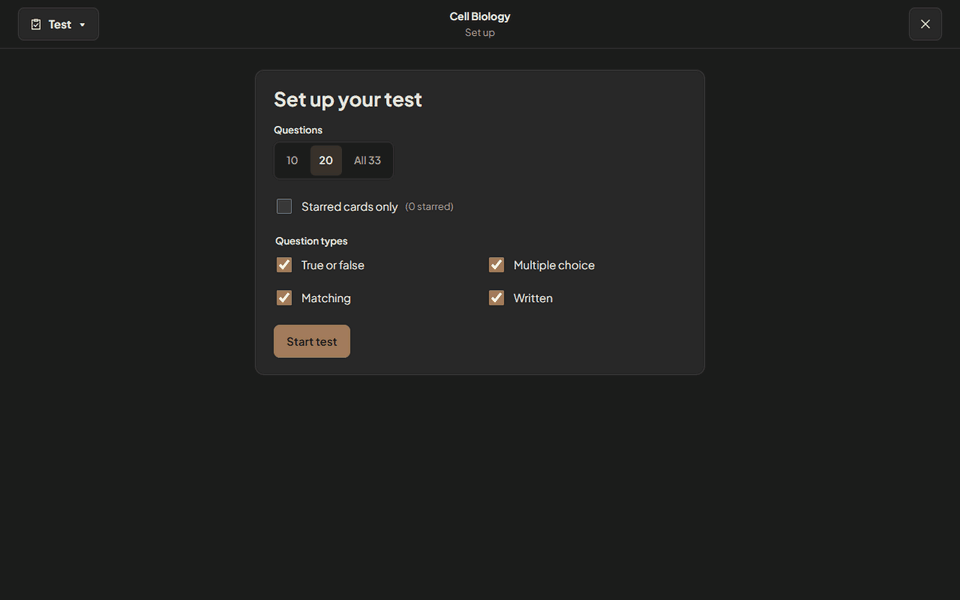
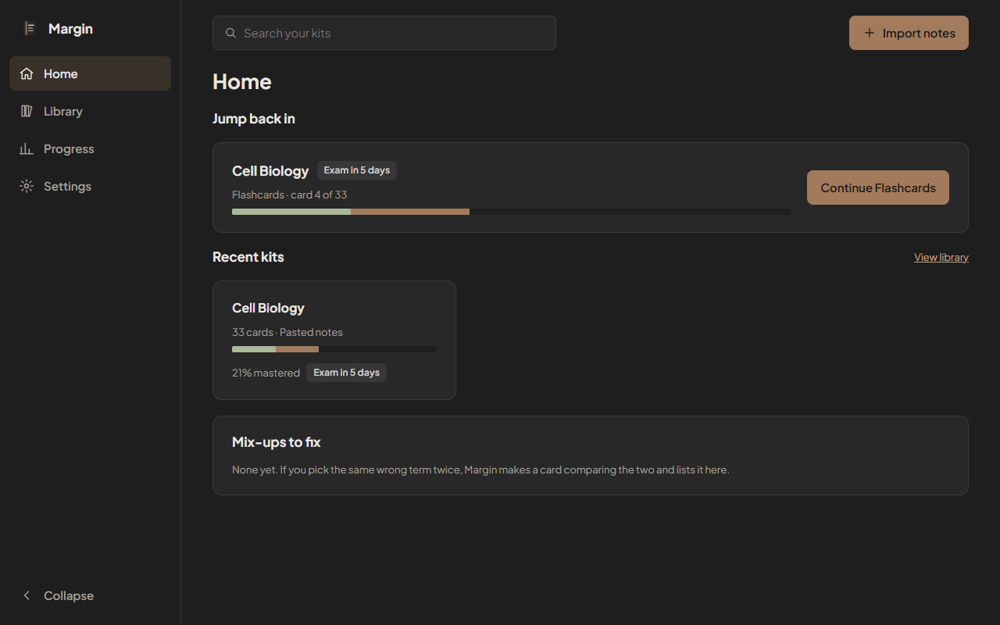
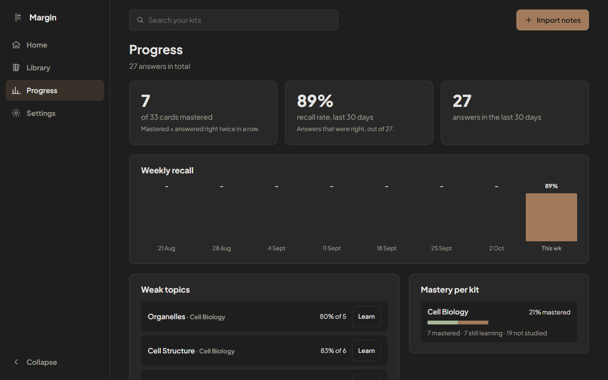
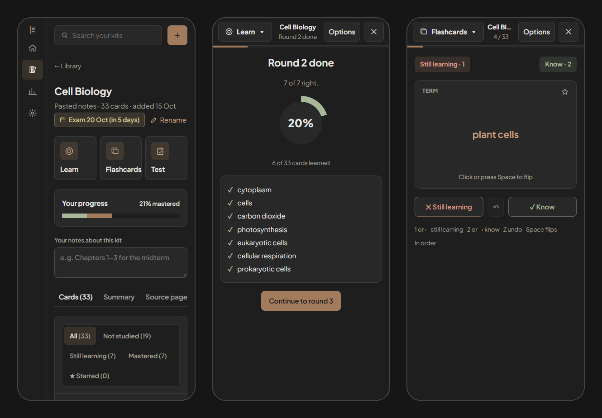

<div align="center">


# Margin

**Turn your own notes into a study set. Learn it, flip through it, test yourself, and see the exact sentence every answer came from.**

[](https://github.com/BrinHan/Study-App/actions/workflows/ci.yml)
[](https://github.com/BrinHan/Study-App/actions/workflows/deploy-pages.yml)


[**Live demo**](https://brinhan.github.io/Study-App/) · [Features](#features) · [Quick start](#quick-start) · [How it works](#how-it-works) · [AI questions](#ai-questions) · [Privacy](#privacy)

<br />


</div>

<br />

## Overview

Margin is a free, browser-based study app. Import a PDF, photos of handwritten notes, or pasted text, and Margin builds a **kit**: a set of fill-in-the-blank and multiple-choice cards drawn from your own material. Study a kit three ways, inspired by the tools students already know:

- **Learn**: adaptive rounds that ask each card as multiple choice, then make you type it.
- **Flashcards**: flip, sort into *Know* and *Still learning*, and repeat what you missed.
- **Test**: a graded practice exam that mixes four question types.

Every answer links back to the **sentence in your notes** it came from, with its page or paragraph. When you pick a wrong option, Margin shows where your notes use that term instead.

There are no accounts and nothing to install. Kits live on your device, and after the first visit the app works offline.

## Features

### Learn

Short rounds of seven cards. Each card starts as multiple choice and comes back as a typed answer once you know it. Cards you miss return first in the next round, and a summary after each round shows your progress through the kit.

<p align="center"></p>

- **Forgiving typed answers.** Case, punctuation and a leading "the/a/an" are ignored, and small typos count as right. An **I was right** button overrides a wrong typed answer.
- **Explanations from your notes.** A wrong answer shows the source passage with the answer highlighted, plus *Why not "your pick"?* from elsewhere in your notes.
- **Your choice of format.** Multiple choice then typed (the default), multiple choice only, or typed only, with rounds of 5, 7 or 10 cards.
- **Pick up where you left off.** Unfinished sessions are saved, and *Jump back in* on Home resumes them.

### Flashcards

<p align="center"></p>

- Flip with a click or <kbd>Space</kbd>. Sort with <kbd>1</kbd>/<kbd>2</kbd> or <kbd>←</kbd>/<kbd>→</kbd>, and undo with <kbd>Z</kbd>.
- At the end of the deck, go through just the *Still learning* pile again.
- Shuffle, start with the term instead of the sentence, or study **starred** cards only.

### Test

<p align="center"></p>

- Choose the length (10, 20 or all cards) and any mix of **True/False**, **Multiple choice**, **Matching** and **Written** questions.
- There's no feedback until you submit, just like a real exam.
- Results show your score, your weakest topic and every answer with its source passage, plus **Learn the cards you missed** in one click.

### Home and progress

<table>
  <tr>
    <td width="50%"></td>
    <td width="50%"></td>
  </tr>
  <tr>
    <td><b>Home</b> resumes your last session, lists recent kits with their mastery, and collects <i>mix-ups</i>: pairs of terms you keep confusing, made into compare cards.</td>
    <td><b>Progress</b> tracks mastery per kit, your recall rate over time, and the topics you get wrong most.</td>
  </tr>
</table>

- **Shared mastery.** Every mode feeds one model per card: *Not studied*, *Still learning*, or *Mastered* (right twice in a row).
- **Exam dates.** Set one from the kit header to get a countdown. From three days out, Margin suggests a practice test.

### Built for your phone

<p align="center"></p>

Margin is a progressive web app. It installs to your home screen, works offline, and every screen is designed for both desktop and phone.

## Quick start

**Requirements:** Node.js 22 or newer.

```bash
npm install
```
```bash
npm run dev
```

Open http://localhost:5173, choose **Import notes**, and paste the contents of [`samples/cell-biology.md`](samples/cell-biology.md) or import [`samples/cell-biology.pdf`](samples/cell-biology.pdf).

| Command | What it does |
|---|---|
| `npm run dev` | Start the development server at http://localhost:5173 |
| `npm test` | Run the unit tests (Vitest) |
| `npm run build` | Type-check and build a static site into `dist/` |
| `npm run preview` | Serve `dist/` with the service worker, to test offline use |
| `npm run sample-pdf` | Regenerate `samples/cell-biology.pdf` (add `-- --pages 50` for the timing file) |

The build is fully static and deploys anywhere. This repository publishes `main` to GitHub Pages on every push.

## How it works

Imports run in a Web Worker, so the page stays responsive. pdf.js loads only when you import a PDF and parses in its own worker. The finished kit is written in a single IndexedDB transaction, so a cancelled import never leaves half a kit behind.

```
notes ─▶ text + locations ─▶ sentences ─▶ key terms (TF-IDF) ─▶ ranking (TextRank) ─▶ cards ─▶ Learn · Flashcards · Test
```

<details>
<summary><b>Card generation pipeline</b></summary>

<br />

1. **Text and locations.** pdf.js extracts text lines per page. Short lines that repeat at the top or bottom of many pages (running headers, "Page 3") are dropped, and lines are joined into paragraphs. Every sentence keeps its page (PDF) or paragraph number (pasted text), plus the heading it sits under, which becomes its topic. A PDF with almost no text per page is reported as scanned.
2. **Sentences.** Paragraphs are split into sentences, with abbreviations such as "e.g." and decimals protected. Fragments, references, URLs, and sentences under 6 or over 55 words are skipped.
3. **TF-IDF terms.** `compromise` (part-of-speech tagging, in the worker) extracts noun phrases such as "plasma membrane". Each term scores `(1 + log tf) × log(1 + N / df)`, where N is the number of sentences, tf the term's total count and df the number of sentences containing it. Multi-word phrases get ×1.3. The top ~25% (15–150 terms) become key terms.
4. **TextRank.** Sentences become TF-IDF vectors. Cosine similarity is computed through an inverted index rather than all pairs, so it stays cheap on long documents. PageRank (damping 0.85, 30 iterations) runs over the similarity graph. High-ranking sentences that contain key terms become cards, and the top 4–6 form the kit summary.
5. **Cards.**
   - *Fill-in-the-blank* cards hide a sentence's highest-scoring key term, spread across terms so one term doesn't take every card.
   - *Multiple-choice* cards add three distractors: other key terms of the same kind and similar length that don't appear in the sentence. Each distractor keeps a pointer to where your notes use it.
   - With fewer than 10 usable sentences, the kit gets simpler questions, and the kit page says why.

`src/gen/generator.ts` exports a `CardGenerator` interface. The built-in generator and the AI generator both implement it, and `src/worker.ts` picks one. Storage, study modes and explanations don't change.

</details>

<details>
<summary><b>Study engine</b></summary>

<br />

The study logic lives in [`src/study/`](src/study) as plain, unit-tested functions. The screens only render its state.

- **Learn** (`learn.ts`) is a round-based state machine. Each card moves from multiple choice to typed to done, depending on the answer format, and a wrong answer keeps it at its stage for a later round. Cards without their own distractors get choices from the kit's other answers (`options.ts`). If a kit has fewer than 4 different answers, Learn asks typed questions only.
- **Typed answers** (`answer.ts`) are normalised, then compared with Levenshtein distance: up to 1 edit for answers of 5 characters or fewer, 2 for longer ones.
- **Flashcards** (`flashcards.ts`) tracks the deck, the two piles and an undo history.
- **Test** (`test.ts`) splits the question count across the chosen types, guarantees at least one matching group of 4–5 distinct terms when matching is selected, and grades with overrides.
- **Mastery** (`mastery.ts`): two right answers in a row make a card *Mastered*, and a wrong answer resets it to *Still learning*. Every answer is logged, and Progress is built from that log.
- **Saved sessions:** unfinished Learn and Flashcards sessions are stored in IndexedDB and pruned if cards were deleted since.
- **Migration:** kits from the earlier spaced-repetition version keep their progress. Cards scheduled 21+ days out become *Mastered*, other reviewed cards *Still learning*, and the rest *Not studied*.

</details>

<details>
<summary><b>Source-linked explanations and mix-ups</b></summary>

<br />

A wrong answer shows:

1. The source passage with the answer highlighted, cited as "file.pdf, page N" or "Pasted notes, paragraph N".
2. *Why not "your pick"?*: the sentence where your notes use the term you chose.
3. For AI-written questions, a short explanation and a reason for each wrong choice.

If a card has no stored source (for example, from an edited backup), Margin finds the closest sentence by TF-IDF cosine similarity and labels it a closest match.

If you pick the same wrong term B for answer A twice, Margin creates a **compare card** with both source sentences and lists it under *Mix-ups to fix* on Home.

</details>

## AI questions

AI is optional. When the proxy is configured and the browser is online, Margin asks AI to write the questions. Otherwise it uses the built-in generator above, with no delay.

```
browser ─▶ proxy (Cloudflare Worker) ─▶ Google Gemini
```

- **Proxy.** [`proxy/`](proxy) is a Worker with the routes `/session`, `/generate`, `/transcribe` and `/clarify`. It holds the Gemini key as a secret, checks the origin, requires a Turnstile-verified session token bound to the IP, and applies per-IP and global rate limits in a Durable Object.
- **Validation.** [`shared/`](shared) holds the question schema and validator used by both sides. Nothing the model returns is trusted until it passes, and AI text is rendered as plain text.
- **Configuration.** The app reads `VITE_AI_PROXY_URL` and `VITE_TURNSTILE_SITEKEY` at build time.
- **Graceful fallback.** Notes are sent in chunks, and a failed chunk falls back to built-in questions on its own. A kill switch (`ENABLED=false`) turns the proxy off for everyone.

To deploy your own proxy or run one locally, see [docs/deploy-proxy.md](docs/deploy-proxy.md).

<details>
<summary><b>Handwriting and scanned PDFs</b></summary>

<br />

Photos of notes and scanned PDF pages are read by Gemini in two passes. The picker accepts JPEG, PNG and WebP photos (plus HEIC where the browser can decode it), as well as PDFs.

1. **Transcribe.** Each page is sent as one image and transcribed faithfully. Anything unclear is marked instead of guessed.
2. **Clarify.** The whole transcript is sent as text, and each mark is resolved using the rest of the document. For example, a lone "E" in a thermodynamics section becomes "E (energy of sublimation)". Low-confidence readings stay visible as "[?]".

- At most 20 AI-read pages per import. Images are downscaled in the browser (1600 px on the longest side) before upload.
- Per-IP limits are 40 requests an hour and 120 a day. The app waits and retries when the proxy is briefly busy.
- If a page can't be read, the import says so ("Read 18 of 20 pages (2 couldn’t be read)") and the transcript marks it.
- In a mixed PDF, only the pages with little text go to AI.

</details>

## Privacy

| | |
|---|---|
| **Stored locally** | Kits, cards, answers and progress live in IndexedDB on your device. They are never uploaded. |
| **With AI off** | If the proxy isn't configured, or you're offline, nothing leaves the device. |
| **With AI on** | The text of your notes (or the photos and scanned pages) is sent to the proxy and on to Google Gemini, and Google's free-tier terms apply. Google may use submitted content to improve its products, so don't import anything you wouldn't send to a third party. |
| **Proxy logs** | No notes, request bodies or raw IP addresses. Logs hold error codes and timings only. IPs are stored as a salted hash, for rate limiting. |
| **Keys** | The Gemini key exists only as a Worker secret. It is never in the app or in git. |

## Performance

Measured on `samples/cell-biology-50p.pdf`: 50 pages, 170 KB, 1,113 sentences, producing 394 cards (the 400-card cap).

| Run | Time to cards |
|---|---|
| In-app import, Chrome, DevTools CPU throttling 6× | **1.9 s** |
| In-app import, no throttling | 1.6 s |
| Same pipeline on the main thread with 6× throttling | **3.2 s** to first card |

DevTools CPU throttling barely affects Web Workers, so the third row runs generation on the throttled main thread for an honest figure. The worst-case estimate on a 6×-slower machine is about **5–6 s** for 50 pages.

**Bundle:** the app loads 123 KB of JS (40 KB gzipped). The worker (compromise and the generator) is 307 KB, and pdf.js (488 KB plus a 1.3 MB worker) loads only when importing a PDF. Everything is precached for offline use.

## Testing

```bash
npm test
```

The study engine, answer checking, mastery and migration, card generation, AI response validation, importer and proxy each have unit tests. CI runs the tests and a type-checked build on every pull request and every push to `main`.

To see storage error states without a private window or a full disk, add `?sim=blocked` or `?sim=full` to the URL, for example `http://localhost:5173/?sim=full#/library`.

<details>
<summary><b>Edge cases the app handles</b></summary>

<br />

| Where | State | What you see |
|---|---|---|
| Home | First launch | What Margin does, plus Choose a PDF or photos / Paste text |
| Home | Nothing studied yet; kit still building | *Start learning* on the newest kit; *Still building* with a link to progress |
| Any | Storage blocked (private window) | An explanation and browser-specific fix steps |
| Library | Importing (cancelable), done, no search match | Step list with Cancel import; card count and time; Show all kits |
| Library | Scanned PDF, over 10 MB, damaged or locked PDF, too little text, storage full | What happened, then Paste text instead / Choose another PDF / Free up space |
| Kit | Still building or interrupted import | Live steps, or *didn't finish* with Delete it and import again |
| Kit | Fewer than 4 cards; short notes | Test disabled with the reason; a *simpler questions* notice |
| Learn, Flashcards | Starred only with nothing starred; deleted cards; answer not saved | A notice with the fix; the session continues without missing cards; Free up space |
| Test | Unanswered questions at Submit | *Submit with N unanswered?* with Keep answering |
| Offline | Any screen | A banner; everything works except installing and checking for updates |

</details>

## Known limitations

- **AI needs internet.** Offline, or without the proxy, you get built-in questions. Scanned PDFs and photos can only be read with AI.
- **Very large notes** (over about 1,200 sentences) get AI questions for the first part and built-in questions for the rest.
- **English only.** Part-of-speech tagging, stopwords and sentence splitting assume English.
- **Card quality depends on the notes.** Dense, complete sentences give the best cards; bullet fragments are skipped, and some distractors are weak.
- **Complex PDF layouts** (multiple columns, tables, footnotes) can be read in the wrong order.
- **No card editor yet.** To change a card, re-import the notes or edit a backup file.
- **No spaced repetition.** Learn brings missed cards back within a session, and mastery shows what's left.
- **Tests in progress aren't saved**, and backups don't include original PDFs or unfinished sessions.

## Project layout

```
src/
  main.tsx, app.tsx      shell: sidebar (232px ↔ 76px), top search bar, focus layout for study modes, routing
  ui.tsx, styles.css     shared components and the flat dark theme (CSS variables)
  screens/               Home, Library, Kit, Learn, Flashcards, Test, Progress, Settings
  screens/study/         study header, source quotes, mastery bar, score ring, star button
  study/                 pure study logic: answer checking, mastery, choices, Learn, Flashcards, Test
  lib/db.ts              IndexedDB stores (kits, sentences, cards, reviews, confusions, files, meta, sessions), migration, backup
  lib/config.ts          build-time AI settings (VITE_AI_PROXY_URL, VITE_TURNSTILE_SITEKEY)
  lib/importer.ts        main-thread import: size/type checks, lazy pdf.js, worker, cancel, errors
  lib/study.ts           loading, recording answers, stats, exam nudge, source lookup
  gen/ai/                AI card generator with per-chunk fallback
  gen/generator.ts       TF-IDF, TextRank, cloze/MCQ, summary (the CardGenerator seam)
  gen/text.ts            tokenizer, sentence splitter, cosine similarity
  worker.ts              runs the generator, writes the kit in one transaction
shared/                  AI question schema, validator and scan helpers (used by app and proxy)
proxy/                   Cloudflare Worker: Gemini proxy, rate limiter, Turnstile (see docs/deploy-proxy.md)
docs/deploy-proxy.md     how to deploy and run the proxy
samples/                 cell-biology.md / .pdf, plus the 50-page timing PDF
scripts/                 dependency-free sample PDF writer
```
