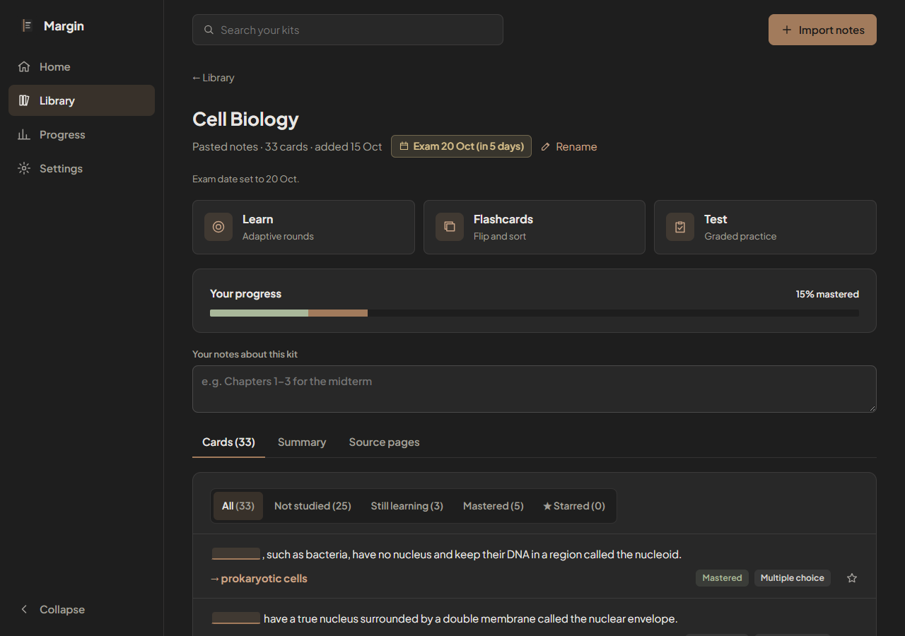
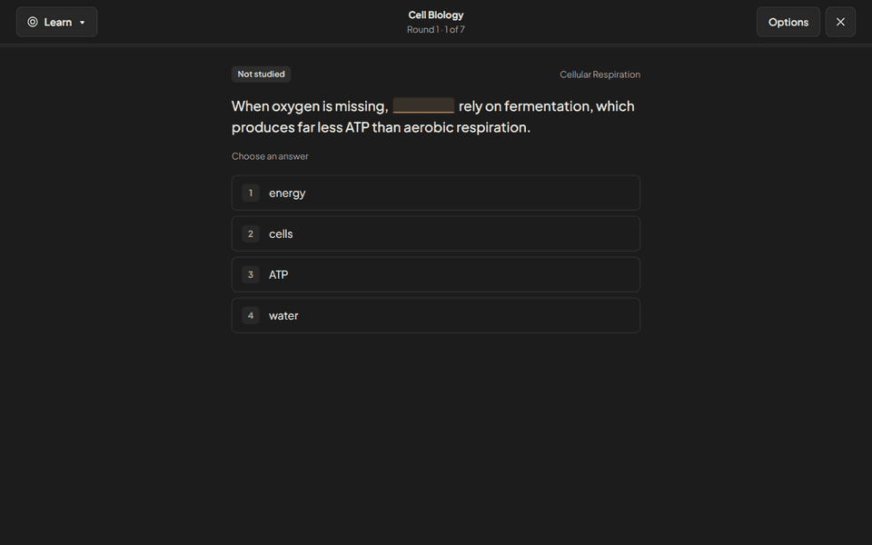
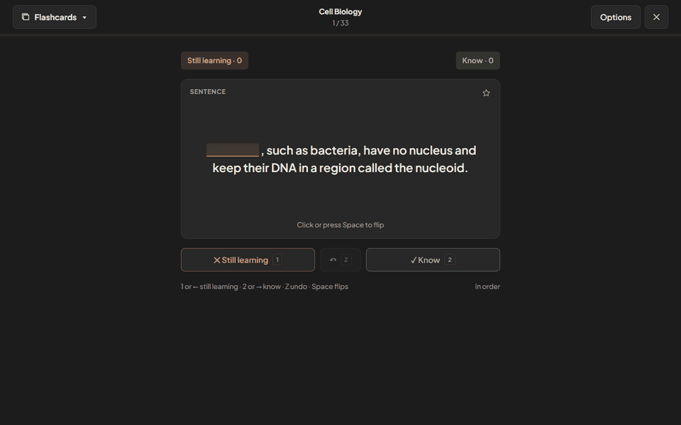

<div align="center">


# Margin

**Turn your own notes into a study set. Learn it, flip through it, test yourself, and see the exact sentence every answer came from.**

[](https://github.com/BrinHan/Study-App/actions/workflows/ci.yml)
[](https://github.com/BrinHan/Study-App/actions/workflows/deploy-pages.yml)


[**Live demo**](https://brinhan.github.io/Study-App/) · [Features](#features) · [Quick start](#quick-start) · [How it works](#how-it-works) · [AI questions](#ai-questions) · [Privacy](#privacy)

<br />



</div>

<br />

## Overview

Margin is a free, browser-based study app. Import a PDF, photos of handwritten notes, or pasted text, and Margin builds a **kit**: a set of fill-in-the-blank and multiple-choice cards drawn from your own material. Study a kit three ways, inspired by the tools students already know:

- **Learn**: adaptive rounds that ask each card as multiple choice, then make you type it.
- **Flashcards**: flip, sort into *Know* and *Still learning*, and repeat what you missed.
- **Test**: a graded practice exam that mixes four question types.

Every answer links back to the **sentence in your notes** it came from, with its page or paragraph. When you pick a wrong option, Margin shows where your notes use that term instead.

There are no accounts and nothing to install. Kits live on your device, and after the first visit the app works offline.

## Features

### Learn

Short rounds of seven cards. Each card starts as multiple choice and comes back as a typed answer once you know it. Cards you miss return first in the next round, and a summary after each round shows your progress through the kit.

<p align="center"></p>

- **Forgiving typed answers.** Case, punctuation and a leading "the/a/an" are ignored, and small typos count as right. An **I was right** button overrides a wrong typed answer.
- **Explanations from your notes.** A wrong answer shows the source passage with the answer highlighted, plus *Why not "your pick"?* from elsewhere in your notes.
- **Your choice of format.** Multiple choice then typed (the default), multiple choice only, or typed only, with rounds of 5, 7 or 10 cards.
- **Pick up where you left off.** Unfinished sessions are saved, and *Jump back in* on Home resumes them.

### Flashcards

<p align="center"></p>

- Flip with a click or <kbd>Space</kbd>. Sort with <kbd>1</kbd>/<kbd>2</kbd> or <kbd>←</kbd>/<kbd>→</kbd>, and undo with <kbd>Z</kbd>.
- At the end of the deck, go through just the *Still learning* pile again.
- Shuffle, start with the term instead of the sentence, or study **starred** cards only.


```bash
npm install
npm run dev        # http://localhost:5173
npm run build      # type-check + production build into dist/ (static, deploy anywhere)
npm run preview    # serve dist/ with the service worker, to test offline
npm run sample-pdf # regenerate samples/cell-biology.pdf (add -- --pages 50 for the timing file)
```

Try it with `samples/cell-biology.pdf` (3 pages) or paste `samples/cell-biology.md`.

## How it works

The import runs in a Web Worker (`src/worker.ts`) so the page stays responsive. pdf.js is loaded only when you import a PDF, and does its parsing in its own worker. The finished kit is written in a single IndexedDB transaction, so a cancelled import never leaves half a kit behind.

**1. Text and locations.** pdf.js extracts text lines per page. Short lines that repeat at the top or bottom of many pages (running headers, "Page 3") are dropped, and lines are joined into paragraphs. Every sentence keeps its page (PDF) or paragraph number (pasted text) plus the heading it sits under, which becomes its topic. A PDF with almost no text per page is reported as scanned.

**2. Sentences.** Paragraphs are split into sentences (abbreviations such as "e.g." and decimals are protected). Fragments, references, URLs and sentences under 6 or over 55 words are skipped.

**3. TF-IDF terms.** `compromise` (part-of-speech tagging, runs in the worker) extracts noun phrases such as "plasma membrane" and "electron transport chain". Each term gets `(1 + log tf) × log(1 + N / df)`, where N is the number of sentences, tf the term's total count, and df the number of sentences containing it. Multi-word phrases get ×1.3. This favours terms that recur but aren't everywhere. The top ~25% (15–150 terms) become key terms.

**4. TextRank.** Sentences are TF-IDF vectors. Cosine similarity is computed through an inverted index rather than all pairs, so it stays cheap on long documents. PageRank (damping 0.85, 30 iterations) runs over the similarity graph. High-ranking sentences that contain key terms become card sentences, and the top 4–6 (with near-duplicates skipped) form the kit summary, in reading order with page references.

**5. Cards.**
- *Cloze:* blank out the sentence's highest-scoring key term. Answers are spread across terms, so one term doesn't take every card.
- *MCQ:* the blank is the answer. Three distractors are other key terms of the same kind (name / plural / phrase / noun) and similar length that don't appear in that sentence. Each distractor keeps a pointer to the sentence where your notes use it.
- With fewer than 10 usable sentences, the kit gets flashcards only and the kit page says why.

**6. Study modes.** Each kit page has three modes. They open full-screen with a mode switcher, and the study logic lives in `src/study/` as plain, unit-tested functions.
- **Learn** asks cards in rounds (7 by default; 5 or 10 in Settings). In the default mode a card is asked as multiple choice, then must be typed. Settings and the Options panel also offer multiple choice only or typed only. Missed cards come back first in the next round. Cards without their own distractors get choices from the kit's other answers. If a kit has fewer than 4 different answers, Learn asks typed questions only.
- **Typed answers** ignore case, punctuation and a leading "the/a/an". Up to 1 typo is allowed for answers of 5 characters or fewer, and 2 for longer ones. "I was right" overrides a wrong typed answer and replaces it in the answer log.
- **Flashcards** flip with a click or Space. Sorting into Know / Still learning (keys 1 and 2, or ← and →) can be turned off, and Z undoes the last sort. Options: shuffle, start with the term, starred only. At the end of the deck you can go through the still-learning pile again.
- **Test** builds a graded sheet of True/False, multiple-choice, matching (4–5 pairs per group) and written questions. Feedback comes only after Submit. Results show the score, the weakest topic, every answer with its source passage, and "Learn the N you missed".
- **Mastery** is shared by all three modes. Two right answers in a row make a card *Mastered*, and a wrong answer puts it back to *Still learning*. Every answer is logged, and Progress is built from that log.
- **Saved sessions:** unfinished Learn and Flashcards sessions are saved on the device, and Home's *Jump back in* resumes the latest one.
- **Exam date:** the kit and Home show a countdown. From 3 days before the exam, the kit suggests a practice test.
- Kits made before study modes keep their progress: an FSRS card reviewed 21+ days out becomes Mastered, other reviewed cards become Still learning, and the rest become Not studied.

**7. Source-linked explanations.** A wrong answer opens three layers:
1. Hint: first letter, word count, and word type.
2. The source passage with the answer highlighted, cited as "file.pdf, page N" or "Pasted notes, paragraph N".
3. "Why not <your pick>?": the sentence where your notes use the term you picked.

If a card has no stored source (for example an edited backup), Margin finds the closest sentence by TF-IDF cosine similarity and labels it a closest match.

**8. Mix-ups.** If you pick the same wrong term B for answer A twice (in Learn or Test), Margin creates a "compare" card with both source sentences and lists it under *Mix-ups to fix* on Home. Compare cards are studied in Flashcards.

**Generator seam.** `src/gen/generator.ts` exports a `CardGenerator` interface. The built-in generator and the AI generator both implement it, and `src/worker.ts` picks one. Storage, the study modes and explanations don’t change.

## AI questions

When the proxy is configured and the browser is online, Margin asks AI to write the questions. Otherwise it uses the built-in generator described above.

```
browser  ->  proxy (Cloudflare Worker)  ->  Google Gemini
```

- **Proxy.** `proxy/` is a Worker with the routes `/session`, `/generate`, `/transcribe` and `/clarify`. It keeps the Gemini key as a secret. It checks the origin, requires a Turnstile-verified session token bound to the IP, and applies per-IP and global rate limits in a Durable Object. Generated questions are cached for a week (on a custom domain only).
- **Shared code.** `shared/` holds the question schema and validator used by both sides. Nothing the model returns is trusted until it passes the validator. AI text is shown as plain text.
- **Configuration.** The app reads `VITE_AI_PROXY_URL` and `VITE_TURNSTILE_SITEKEY` at build time. If either is unset, the app behaves as it did before and adds no delay.
- **Fallback.** Notes are sent in chunks. If a chunk fails, only that chunk falls back to built-in questions. A kill switch (`ENABLED=false`) turns the proxy off for everyone.
- **Explanations.** AI questions show the source passage from your notes, plus a short explanation and a reason for each wrong choice.

To deploy your own proxy, or to run it locally, see [docs/deploy-proxy.md](docs/deploy-proxy.md).

### Handwriting and scanned PDFs

Photos of notes and scanned PDF pages are read by Gemini in two passes. The picker accepts photos (JPEG, PNG, WebP, and HEIC where the browser can decode it) as well as PDFs.

1. **Transcribe.** Each page is sent as one image and transcribed faithfully. Anything unclear is marked instead of guessed.
2. **Clarify.** The whole transcript is sent as text, and each mark is resolved using the rest of the document. For example, a lone "E" in a thermodynamics section becomes "E (energy of sublimation)". Low-confidence readings are kept visible as "[?]". If this pass fails, the kit is still made from the first pass.

Details:
- Photos and scanned pages are sent to Google Gemini. This needs internet.
- At most 20 AI-read pages per import.
- Images are downscaled in the browser (1600 px on the longest side, JPEG) before upload.
- Per-IP limits are 40 requests an hour and 120 a day. When the proxy is briefly busy, the app waits and retries.
- If a page still can't be read, the import says so ("Read 18 of 20 pages (2 couldn’t be read)") and the transcript marks the page. Import it again to add it.
- In a mixed PDF, only the pages with little text go to AI.
- The full transcript is saved on the kit. There is no viewer for it yet.

## Privacy

- **With AI on:** the text of your notes (or the photos and scanned pages) is sent to the proxy and on to Google Gemini. Google's free-tier terms apply to that data. On Gemini's free tier, Google may use submitted content to improve its products. Don't import anything you wouldn't send to a third party.
- **What the proxy keeps:** it doesn't log notes, request bodies or raw IP addresses. Logs hold error codes and timings only. IPs are stored only as a salted hash, for rate limiting (IPv6 addresses by their /64 prefix).
- **What stays local:** your kits, cards, reviews and progress live in IndexedDB on your device. They are never uploaded.
- **With AI off:** if the proxy isn't configured, or you're offline, nothing leaves the device.
- **Keys:** the Gemini key exists only as a Worker secret. It is never in the app or in git.

## Performance (measured)

Test file: `samples/cell-biology-50p.pdf`, 50 pages, 170 KB. It's the sample notes repeated with numbered sections: 1,113 sentences, which yield 394 cards (the 400-card cap).

| Run | Time to cards |
|---|---|
| In-app import, Chrome, DevTools CPU throttling 6× | **1.9 s** |
| In-app import, no throttling | 1.6 s |
| Same pipeline run on the main thread with 6× throttling (pdf.js read 0.4 s + generation 2.9 s) | **3.2 s to first card** |

DevTools CPU throttling barely affects Web Workers, which is why the first two numbers are close. The third row runs generation on the throttled main thread to get an honest 6× figure. The pdf.js parse (0.4 s there) wasn't throttled. At a full 6× it would be at most about 2.4 s, so the **worst-case estimate on a 6×-slower machine is about 5–6 s** for 50 pages. Cards are saved in one transaction, so the first card appears when the whole kit does.

Bundle: the app loads 108 KB of JS (36 KB gzipped). The worker (compromise + generator) is 298 KB, and pdf.js (488 KB + 1.3 MB worker) loads only when importing a PDF. Everything is precached for offline use (2.2 MB).

## States that aren't the happy path

| Where | State | What the user sees |
|---|---|---|
| Home | First launch | What Margin does, plus Choose a PDF or photos / Paste text |
| Home | Nothing studied yet; kit still building | "Start learning" on the newest kit; "Still building" with a link to progress |
| Any | Storage blocked (private window) | Explanation and browser-specific fix steps |
| Library | Empty, importing (cancelable), done, no search match | Step list with Cancel import; card count, time, Start learning; Show all kits |
| Library | Scanned PDF, > 10 MB, damaged/locked PDF, too little text, storage full | What happened, then Paste text instead / Choose another PDF / Free up space in Settings |
| Kit | Still building / interrupted import | Live steps, or "didn't finish" with Delete it and import again |
| Kit | Fewer than 4 cards; short notes | Test tile disabled with the reason; "simpler questions" notice |
| Learn / Flashcards | Starred only with nothing starred; saved session with deleted cards; answer not saved | Notice with the fix; the session drops missing cards and continues; Free up space |
| Test | Unanswered questions at Submit | "Submit with N unanswered?" with Keep answering |
| Progress | No answers; under 20 answers | Start learning; recall rate hidden with the reason |
| Offline | Banner | Everything works; only Install app and Check for updates are disabled |

To see storage states without a private window or a full disk, add `?sim=blocked` or `?sim=full` to the URL (for example `http://localhost:5173/?sim=full#/library`).

## Known limitations

- **AI questions need internet.** Offline, or without the proxy, you get the built-in questions.
- **Very large notes are only partly covered by AI.** Notes over about 1,200 sentences get AI questions for the first part and built-in questions for the rest.
- **Handwriting is capped at 20 pages** per import, and reading it needs internet.
- **AI can make mistakes.** The source passage is shown with every question so you can check it. Handwriting transcripts can also be wrong.
- **No transcript viewer yet.** The transcript is saved on the kit, but you can't see or edit it. That is planned for a later UI phase.
- **No offline OCR.** Scanned PDFs and photos are read by AI only. Offline, a scanned PDF shows the "scanned" error.
- **English only.** The POS tagging, stopwords and sentence splitting assume English.
- Card quality depends on the notes. Dense, complete sentences give good cards. Bullet fragments are skipped. Some distractors are weak (for example "carbon sugar" from "five-carbon sugar"), and the generator sometimes blanks a word that's part of a longer phrase.
- PDF layout: multi-column pages, tables and footnotes can be joined in the wrong order, because pdf.js returns text in drawing order.
- Exact duplicate sentences aren't merged (the 50-page timing file shows this).
- There's no card editing UI. To change a card, delete the kit and re-import, or edit a backup file.
- A Test in progress isn't saved; leaving the page discards it (finished tests are saved as answers).
- No spaced repetition: Margin doesn't schedule reviews. Learn brings missed cards back within a session, and mastery shows what's left.
- Backups don't include the original PDFs or unfinished sessions. "Open original PDF" stops working after you remove them in Settings.

## Project layout

```
src/
  main.tsx, app.tsx      shell: sidebar (232px ↔ 76px), top search bar, focus layout for study modes, routing
  ui.tsx, styles.css     shared components and the flat dark theme (CSS variables)
  screens/               Home, Library, Kit, Learn, Flashcards, Test, Progress, Settings
  screens/study/         study header, source quotes, mastery bar, score ring, star button
  study/                 pure study logic: answer checking, mastery, choices, Learn, Flashcards, Test
  lib/db.ts              IndexedDB stores (kits, sentences, cards, reviews, confusions, files, meta, sessions), migration, backup
  lib/config.ts          build-time AI settings (VITE_AI_PROXY_URL, VITE_TURNSTILE_SITEKEY)
  lib/importer.ts        main-thread import: size/type checks, lazy pdf.js, worker, cancel, errors
  lib/study.ts           loading, recording answers, stats, exam nudge, source lookup
  gen/ai/                AI card generator with per-chunk fallback
  gen/generator.ts       TF-IDF, TextRank, cloze/MCQ, summary (the CardGenerator seam)
  gen/text.ts            tokenizer, sentence splitter, cosine similarity
  worker.ts              runs the generator, writes the kit in one transaction
shared/                  AI question schema, validator and scan helpers (used by app and proxy)
proxy/                   Cloudflare Worker: Gemini proxy, rate limiter, Turnstile (see docs/deploy-proxy.md)
docs/deploy-proxy.md     how to deploy and run the proxy
samples/                 cell-biology.md / .pdf, plus the 50-page timing PDF
scripts/                 dependency-free sample PDF writer
```
